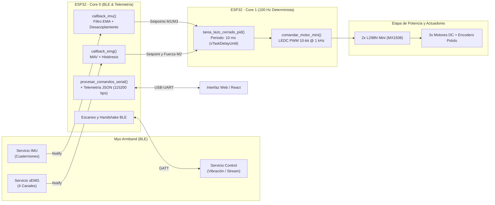

# MyoMechArm — Brazo Robótico Mioeléctrico de 3 Grados de Libertad (3-DOF)

Sistema embebido de control mioeléctrico inalámbrico para un brazo robótico de **3 grados de libertad (3-DOF)**, gobernado mediante un brazalete **Thalmic Labs Myo Armband** a través de **Bluetooth Low Energy (BLE)** y procesado en tiempo real sobre un microcontrolador **ESP32** con arquitectura **FreeRTOS Dual-Core**.

---

## Tabla de Contenidos

1. [Resumen Ejecutivo](#resumen-ejecutivo)
2. [Arquitectura del Sistema (Dual-Core FreeRTOS)](#arquitectura-del-sistema-dual-core-freertos)
3. [Hardware y Mapa de Conexiones (Pinout)](#hardware-y-mapa-de-conexiones-pinout)
4. [Protocolo BLE GATT con Myo Armband](#protocolo-ble-gatt-con-myo-armband)
5. [Procesamiento Digital de Señales (IMU y sEMG)](#procesamiento-digital-de-señales-imu-y-semg)
6. [Estrategia de Control y Etapa de Potencia](#estrategia-de-control-y-etapa-de-potencia)
7. [Protocolo de Telemetría y Comandos Seriales](#protocolo-de-telemetría-y-comandos-seriales)
8. [Compilación y Despliegue (PlatformIO)](#compilación-y-despliegue-platformio)

---

## Resumen Ejecutivo

El proyecto **MyoMechArm** traduce la intención motora del usuario (orientación espacial del antebrazo y contracción muscular) en movimientos suaves, desacoplados y precisos sobre tres actuadores electromecánicos:

| Eje / Actuador | Función Mecánica | Señal de Control (Myo) | Rango Operativo |
| :--- | :--- | :--- | :--- |
| **Motor 1 (M1)** | Elevación del brazo (*Pitch*) | Cuaternión IMU (inclinación vertical) | $-40.0^\circ$ a $+40.0^\circ$ ($2.333\text{ pulsos}/^\circ$) |
| **Motor 2 (M2)** | Apertura y cierre de pinza (*Gripper*) | Envolvente sEMG (MAV + histéresis) | $0$ a $210$ pulsos (control de fuerza) |
| **Motor 3 (M3)** | Rotación de la base (*Yaw*) | Cuaternión IMU (giro horizontal) | $-60.0^\circ$ a $+60.0^\circ$ ($2.333\text{ pulsos}/^\circ$) |

---

## Arquitectura del Sistema (Dual-Core FreeRTOS)

Para garantizar determinismo en el lazo de control de los motores sin interferir con la pila inalámbrica BLE ni con la transmisión serial, la carga de trabajo se divide entre los dos núcleos del **ESP32**:



- **Core 0 (`loop()` + pila BLE):** Gestiona el escaneo activo BLE (`ESP32_Myo_3DOF`), la reconexión automática, los *callbacks* de notificación GATT, el análisis de comandos entrantes por UART y la emisión de telemetría JSON cada `~30 ms` (o `~100 ms` en estado desconectado).
- **Core 1 (`tarea_lazo_cerrado_pid`):** Tarea FreeRTOS fijada al núcleo 1 con prioridad `3` y pila de `4096 bytes`. Ejecuta un ciclo estricto cada `10 ms` (`100 Hz`) mediante `vTaskDelayUntil`.

---

## Hardware y Mapa de Conexiones (Pinout)

### Componentes Principales
- **Microcontrolador:** ESP32 (`esp32dev`).
- **Sensor Biométrico:** Thalmic Labs Myo Armband (IMU 9-DOF + 8 sensores sEMG).
- **Drivers de Potencia:** 2 módulos **L298N Mini** (basados en el puente H **MX1508**).
- **Actuadores:** 3 motores DC con caja reductora y encoders magnéticos de cuadratura **Pololu** (canales `C1`/`A` y `C2`/`B`).

### Tabla de Pines (ESP32)

| Subsistema | Señal | GPIO ESP32 | Periférico / Canal | Descripción |
| :--- | :--- | :---: | :--- | :--- |
| **Motor 1 (Elevación)** | `M1_IN1_PIN` | `26` | `PWM_CH_M1_IN1` (Ch 0) | L298N Mini 1 — Entrada IN1 |
| | `M1_IN2_PIN` | `27` | `PWM_CH_M1_IN2` (Ch 1) | L298N Mini 1 — Entrada IN2 |
| | `ENC1_C1_PIN` | `34` | `PCNT_UNIT_0` (Ch 0) | Encoder Pololu M1 — Canal A |
| | `ENC1_C2_PIN` | `35` | `PCNT_UNIT_0` (Ch 1) | Encoder Pololu M1 — Canal B |
| **Motor 2 (Pinza)** | `M2_IN3_PIN` | `12` | `PWM_CH_M2_IN3` (Ch 2) | L298N Mini 1 — Entrada IN3 |
| | `M2_IN4_PIN` | `13` | `PWM_CH_M2_IN4` (Ch 3) | L298N Mini 1 — Entrada IN4 |
| | `ENC2_C1_PIN` | `32` | `PCNT_UNIT_1` (Ch 0) | Encoder Pololu M2 — Canal A |
| | `ENC2_C2_PIN` | `33` | `PCNT_UNIT_1` (Ch 1) | Encoder Pololu M2 — Canal B |
| **Motor 3 (Base Yaw)** | `M3_IN1_PIN` | `25` | `PWM_CH_M3_IN1` (Ch 4) | L298N Mini 2 — Entrada IN1 |
| | `M3_IN2_PIN` | `14` | `PWM_CH_M3_IN2` (Ch 5) | L298N Mini 2 — Entrada IN2 |
| | `ENC3_C1_PIN` | `18` | `PCNT_UNIT_2` (Ch 0) | Encoder Pololu M3 — Canal A |
| | `ENC3_C2_PIN` | `19` | `PCNT_UNIT_2` (Ch 1) | Encoder Pololu M3 — Canal B |
| **Indicadores** | `PIN_LED_PINZA` | `4` | Salida Digital | LED testigo de cierre de pinza |
| | `PIN_LED_INTEGRADO` | `2` | Salida Digital | Parpadeo en espera / fijo al cerrar pinza |

> **Nota sobre Contadores de Pulsos (`PCNT`):** Los 3 encoders se inicializan en modo **cuadratura x4** (`inicializar_pcnt_x4`) mediante el periférico hardware `PCNT` del ESP32, con resistencias *pull-up* internas, límites de $\pm 30000$ y filtro digital de rebotes (`pcnt_set_filter_value(..., 100)`).

---

## Protocolo BLE GATT con Myo Armband

El ESP32 actúa como **Cliente BLE** y busca dispositivos que anuncien el UUID del servicio de control de Myo (`d5060001-a904-deb9-4748-2c7f4a124842`).

### UUIDs Suscritos
- **Control:** Servicio `d5060001-a904-deb9-4748-2c7f4a124842` / Característica `d5060401-a904-deb9-4748-2c7f4a124842`
- **IMU:** Servicio `d5060002-a904-deb9-4748-2c7f4a124842` / Característica `d5060402-a904-deb9-4748-2c7f4a124842`
- **sEMG (4 canales):** Servicio `d5060005-a904-deb9-4748-2c7f4a124842` / Características `d5060105...` a `d5060405...`

### Secuencia de *Handshake* (`conectar_y_configurar_myo`)
1. **Deshabilitar modo reposo (*Never Sleep*):** `{0x09, 0x01, 0x01}`
2. **Desbloquear brazalete (*Unlock*):** `{0x0A, 0x01, 0x02}`
3. **Confirmación háptica (vibración):** `{0x03, 0x01, 0x02}`
4. **Activar transmisión continua de sEMG + IMU:** `{0x01, 0x03, 0x02, 0x01, 0x00}`

---

## Procesamiento Digital de Señales (IMU y sEMG)

### 1. Orientación Espacial desde Cuaterniones (`callback_imu`)
Cada notificación IMU entrega 8 bytes correspondientes a 4 enteros de 16 bits en formato punto fijo Q14 (escala `16384.0f`): $q_w, q_x, q_y, q_z$.

- **Conversión a ángulos de Euler (grados):**
  $$\text{Pitch} = \arcsin\big(\text{constrain}(2(q_w q_y - q_z q_x), -1, 1)\big) \cdot \frac{180}{\pi}$$
  $$\text{Yaw} = \text{atan2}\big(2(q_w q_z + q_x q_y),\, 1 - 2(q_y^2 + q_z^2)\big) \cdot \frac{180}{\pi}$$
- **Calibración de Cero Relativo:** El primer paquete recibido fija `pitch_offset_inicial` y `yaw_offset_inicial` como referencia $0^\circ$ (con corrección de discontinuidad $\pm 180^\circ$ en *Yaw*).
- **Filtro Pasa-Bajas (EMA):** Suavizado exponencial con factor $\alpha = 0.25$:
  $$y[n] = 0.25\,x[n] + 0.75\,y[n-1]$$
- **Banda Muerta de Reposo:** Ángulos dentro de $\pm 4.5^\circ$ (`ZONA_CERO_PITCH` y `ZONA_CERO_YAW`) se fijan a $0.0^\circ$ para evitar deriva en reposo.
- **Desacoplamiento de Ejes e Histéresis:** Con histéresis de $3.5^\circ$ (`HIST_ESTABILIDAD_PITCH` / `HIST_ESTABILIDAD_YAW`), el algoritmo prioriza el eje con variación dominante ($\Delta_{\text{eje}} \ge 1.15\,\Delta_{\text{opuesto}}$) o exige superar $1.6\times$ el umbral de histéresis, evitando que un giro horizontal (*Yaw*) altere involuntariamente la elevación (*Pitch*).

### 2. Envolvente Muscular sEMG (`callback_emg`)
Cada paquete sEMG contiene 16 muestras con signo (`int8_t`):
1. **Rectificación y Valor Medio Absoluto (MAV):**
   $$\text{MAV} = \frac{1}{16}\sum_{i=0}^{15} |x_i|$$
2. **Suavizado Exponencial (EMA):** Factor $\alpha = 0.22$ para obtener `envolvente_emg`.
3. **Disparador Schmitt (Histéresis de Pinza):**
   - **Cierre (`estado_pinza_cerrada = true`):** cuando `envolvente_emg >= 24.0` (`umbral_apretar_pinza`). Fija `setpoint_pinza_pulsos = 210.0`.
   - **Apertura (`estado_pinza_cerrada = false`):** cuando `envolvente_emg <= 18.0` (`umbral_soltar_pinza`). Fija `setpoint_pinza_pulsos = 0.0`.

---

## Estrategia de Control y Etapa de Potencia

### Controlador PD con Banda Muerta (`ControladorPID`)
Se instancia un controlador por eje con $K_i = 0$ para eliminar el *windup* integral y evitar que los motores queden energizados o vibrando en reposo:

| Controlador | $K_p$ | $K_i$ | $K_d$ | Salida Máxima |
| :--- | :---: | :---: | :---: | :---: |
| `pid_elevacion` (M1) | `5.0` | `0.0` | `0.35` | `850.0` |
| `pid_pinza` (M2) | `4.5` | `0.0` | `0.25` | `700.0` |
| `pid_base` (M3) | `5.0` | `0.0` | `0.35` | `850.0` |

- **M1 (Elevación) y M3 (Base):** Avanzan hacia su *setpoint* mediante estimación cinemática con paso `0.65 pulsos / 10 ms` ($\approx 65\text{ pulsos/s} \approx 28^\circ/\text{s}$) y banda muerta de `0.8 pulsos`. Al alcanzar la referencia, la señal de control cae a `0.0` y se reinicia el controlador.
- **M2 (Pinza con Control de Impedancia / Fuerza Activa):** Con el puño relajado se corta por completo la energía (`0.0`). Al contraer el músculo, aplica una rampa de cierre (`MAX_PASO_RAMPA_PINZA = 6.0`) y modula la fuerza de apriete proporcionalmente al exceso de señal sEMG sobre el umbral:
  $$u_{\text{pinza}} = \text{constrain}\big(470.0 + \text{constrain}((\text{EMG} - u_{\text{on}}) \cdot 10.0,\, 0,\, 380),\, 470,\, 850\big)$$

### Etapa de Potencia PWM (`comandar_motor_mini`)
- Frecuencia PWM de **1000 Hz** y resolución de **10 bits** (`0` a `1023`), optimizada para el integrado **MX1508** del L298N Mini.
- **Corte en zona muerta:** Magnitudes `< 35` apagan ambos canales del puente H (`0`).
- **Compensación de fricción estática:** El rango activo `[35, 850]` se mapea linealmente al ciclo de trabajo `[220, 1023]` para asegurar el arranque inmediato de los motores bajo carga.

---

## Protocolo de Telemetría y Comandos Seriales

Comunicación UART bidireccional a **115200 baudios** diseñada para integrarse con una interfaz de monitoreo y calibración (por ejemplo, una aplicación web en React mediante Web Serial API).

### Comandos Entrantes (PC $\rightarrow$ ESP32)

| Comando | Acción |
| :--- | :--- |
| `CAL_ZERO` | Recalibra el cero actual de *Pitch* y *Yaw*, reinicia contadores PCNT, *setpoints* y PIDs, y envía vibración corta al Myo. |
| `FLIP_M1` / `FLIP_M2` / `FLIP_M3` | Invierte el sentido lógico (`dir_encoder_mX`) del motor/encoder correspondiente sin recablear. |
| `VIBRATE` | Envía un pulso de vibración corta (`{0x03, 0x01, 0x01}`) al brazalete Myo. |
| `SET_UMBRAL:<on>,<off>` | Actualiza dinámicamente los umbrales de histéresis sEMG (valida `on > 2.0`, `off >= 1.0` y `on > off`). |

### Telemetría Saliente (ESP32 $\rightarrow$ PC)

- **En espera de conexión:**
  ```json
  {"conectado":false}
  ```
- **En operación:**
  ```json
  {"conectado":true,"pitch":12.50,"yaw":-18.30,"leds":5,"emg":26.40,"uOn":24.0,"uOff":18.0,"pinza":1,"posM1":29,"spM1":29.2,"posM2":210,"spM2":210.0,"posM3":-43,"spM3":-42.7}
  ```

---

## Compilación y Despliegue (PlatformIO)

### Requisitos
- [PlatformIO Core / IDE](https://platformio.org/)
- Plataforma `espressif32@6.9.0` (framework `arduino`, placa `esp32dev`)

### Comandos

```bash
# Compilar el firmware
pio run

# Cargar el firmware al ESP32
pio run --target upload

# Abrir monitor serial a 115200 baudios
pio device monitor -b 115200
```

---

## Licencia y Autoría

Proyecto desarrollado por **Víctor Hugo Pérez Cruz** — Repositorio: [MyoMechArm](https://github.com/victorhugoperezcruz/MyoMechArm).
